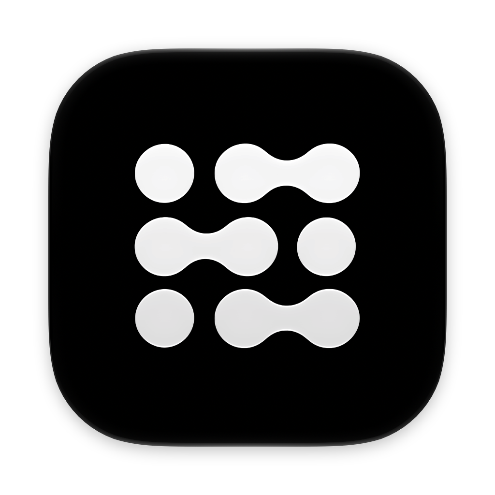
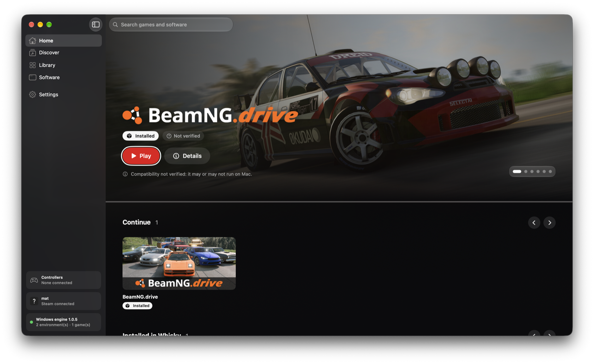
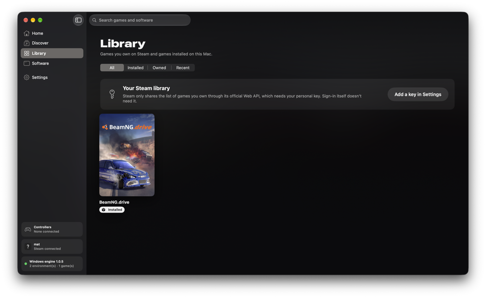
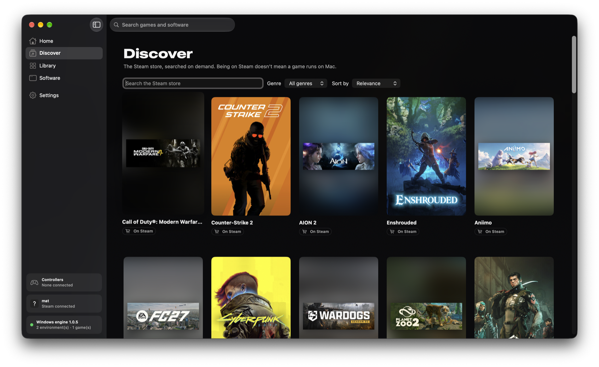
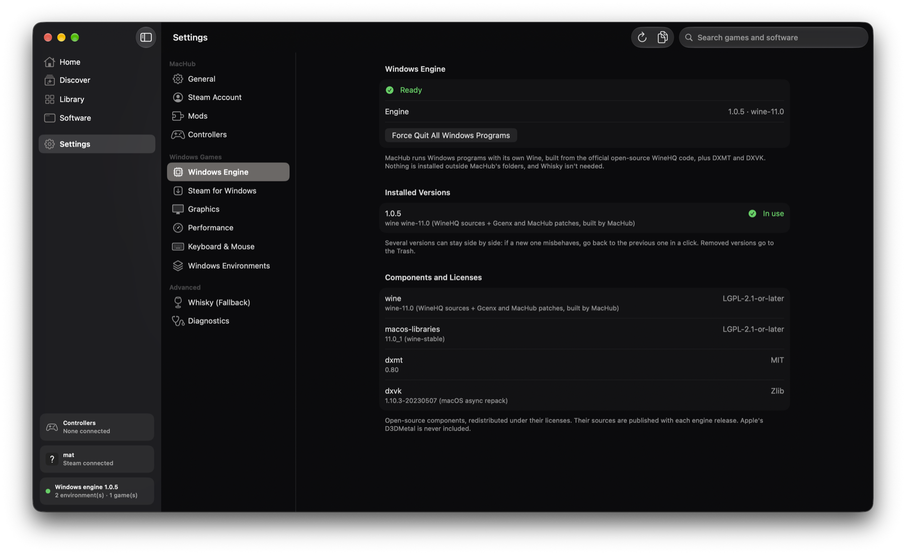
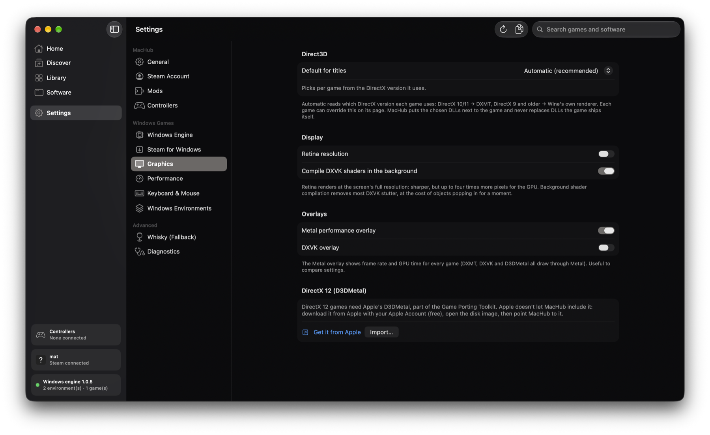
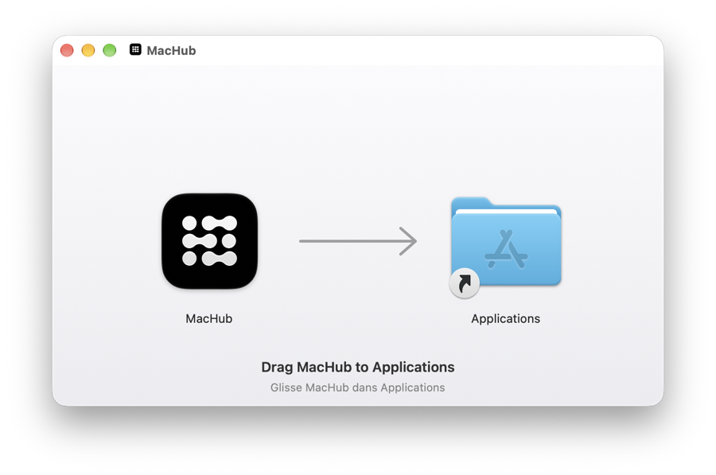
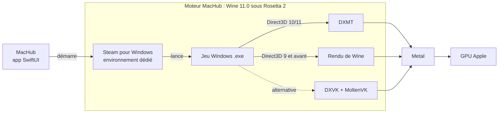

<p align="center">
  
</p>

<h1 align="center">MacHub</h1>

<p align="center">
  <b>Joue à tes jeux Windows sur un Mac à puce Apple.</b><br>
  Une bibliothèque, un clic pour jouer, un clic pour les mods. Gratuit et open source.
</p>

<p align="center">
  <a href="https://github.com/machub-app/machub/releases/latest"></a>
  <a href="https://github.com/machub-app/machub/releases"></a>
  
  
  <a href="LICENSE"></a>
</p>

<p align="center">
  <a href="https://github.com/machub-app/machub/releases/latest"><b>Télécharger MacHub</b></a> ·
  <a href="#installation">Installation</a> ·
  <a href="#comment-ça-marche">Comment ça marche</a> ·
  <a href="#questions-fréquentes">FAQ</a> ·
  <a href="README.md">English</a>
</p>

<p align="center">
  
</p>

---

## MacHub, c'est quoi ?

La plupart des jeux sont faits pour Windows. MacHub permet de les installer et d'y jouer sur ton Mac, sans Windows, sans machine virtuelle et sans outil payant.

MacHub est une app macOS native (SwiftUI). Elle réunit tout dans une bibliothèque façon console :

- ton **compte Steam** et la boutique ;
- un **moteur de compatibilité Windows** intégré à l'app (Wine, DXMT et DXVK), sans Whisky, CrossOver ni rien d'autre ;
- **Steam pour Windows**, installé pour toi dans son propre environnement Windows isolé ;
- les **mods**, installés en toute sécurité et retirés en un clic.

Tu te connectes à Steam, tu choisis un jeu, tu cliques sur **Installer**, puis sur **Jouer**.

## Fonctionnalités

### 🎮 Une seule bibliothèque pour tous tes jeux
- Tes jeux Steam, ce qui est installé sur ce Mac et tes derniers jeux, au même endroit.
- **Découvrir :** la boutique Steam depuis MacHub, avec une fiche par jeu.
- Les jeux Mac natifs sont reconnus et ouverts via Steam pour Mac, sans Wine.

<p align="center"> </p>

### 🍷 Un moteur Windows intégré
- **Wine 11.0**, compilé par MacHub à partir des sources officielles de WineHQ, avec nos propres correctifs pour macOS.
- **DXMT** traduit Direct3D 10 et 11 en Metal : le chemin le plus rapide pour les jeux DirectX 11 sur puce Apple.
- **DXVK** reste disponible pour les jeux qui se comportent mal avec DXMT.
- Les versions du moteur cohabitent et sont vérifiées par SHA-256. Si une nouvelle pose problème, on revient à la précédente en un clic.
- Chaque environnement Windows est isolé : réglages, sauvegardes et programmes ne se mélangent jamais, et rien n'est installé hors des dossiers de MacHub.

### 🚂 Steam pour Windows, géré pour toi
- MacHub télécharge l'installateur officiel de Valve et installe Steam dans son propre environnement.
- Tu te connectes dans la fenêtre de Steam. **MacHub ne voit jamais ton mot de passe.**
- Téléchargements, mises à jour et vérifications sont suivis dans MacHub.

### ⚙️ Des réglages par jeu
- **Couche Direct3D choisie automatiquement** selon la version de DirectX du jeu, ou à la main.
- **Options de lancement**, comme dans Steam (par exemple `-gfx dx11`).
- **Résumé de performances** après chaque session (FPS moyen, creux, mémoire), lu dans le compteur Metal de macOS. Rien n'est injecté dans le jeu.
- Dans le menu **…** du jeu : Mettre à jour, Vérifier les fichiers, Afficher le dossier, Propriétés Steam, Arrêter, Désinstaller.

<p align="center"> </p>

### 🧩 Des mods, sans risque
- **Catalogue Nexus Mods** pour BeamNG.drive, Cyberpunk 2077 et Dead Island 2 : recherche, tri, installation en un clic, activation, suppression propre.
- **Modrinth** pour Minecraft Java, avec un profil Fabric séparé pour que tes mondes restent intacts.
- **Assetto Corsa :** import sécurisé de voitures et de circuits en `.zip`.
- Chaque fichier remplacé par MacHub est sauvegardé d'abord, et retirer un mod le remet en place.

### 🕹️ Manettes
- Vois toutes les manettes détectées par macOS (Xbox, DualSense, DualShock, Switch Pro, MFi), teste chaque bouton et la vibration, et vérifie ce que reçoivent les jeux Windows.

## Installation

1. **Télécharge** `MacHub.dmg` depuis la [dernière version](https://github.com/machub-app/machub/releases/latest).
2. Ouvre-le et **glisse MacHub dans Applications**.

   

3. **Ouvre MacHub une première fois** (voir [Premier lancement](#premier-lancement) ci-dessous : macOS demande une confirmation, une seule fois).
4. Si Rosetta 2 n'est pas encore installé, MacHub affiche la commande à lancer (Wine passe par le traducteur d'Apple).
5. Dans **Réglages › Moteur Windows**, MacHub télécharge son moteur (environ 240 Mo, une seule fois).
6. Dans **Réglages › Steam pour Windows**, clique sur **Installer Steam pour Windows**, puis connecte-toi dans la fenêtre de Steam.
7. Choisis un jeu, clique sur **Installer**, puis sur **Jouer**.

**Configuration requise :** un Mac à puce Apple (M1 ou plus récent), macOS 15 ou plus récent, et de la place pour tes jeux.

### Premier lancement

MacHub n'est pas encore notarisé par Apple (il faut pour cela un compte développeur payant). La première fois, macOS dit donc qu'il ne peut pas vérifier l'app. C'est normal pour les apps Mac open source, et ça ne se fait qu'une fois :

1. Ouvre MacHub depuis Applications. macOS affiche un avertissement : clique sur **Terminé**.
2. Ouvre **Réglages Système › Confidentialité et sécurité**, descends et clique sur **Ouvrir quand même** à côté de MacHub, puis confirme avec ton mot de passe ou Touch ID.

Ou, dans Terminal :

```bash
xattr -dr com.apple.quarantine /Applications/MacHub.app
```

Tu peux vérifier ce que tu lances : tout le code source est ici, et chaque version indique l'empreinte SHA-256 de son `.dmg`.

## Comment ça marche



- **Wine** traduit les appels Windows en appels macOS. Il est compilé pour Intel et passe par Rosetta 2.
- **DXMT** et **DXVK** traduisent Direct3D en Metal, le langage du GPU Apple.
- MacHub lit les imports de chaque jeu pour choisir la bonne couche. Il place les DLL à côté du jeu et ne remplace jamais celles que le jeu fournit.
- Le moteur est publié dans sa propre release, avec ses sources et correctifs exacts ([docs/ENGINE.md](docs/ENGINE.md)).

## Jeux testés

| Jeu | État | Remarques |
|---|---|---|
| BeamNG.drive | ✅ Jouable | Direct3D 11 via DXMT. `-gfx dx11` saute le lanceur du jeu |
| Assetto Corsa | ⚠️ Lanceur seulement | Le menu du lanceur reste noir sous Wine |

MacHub n'annonce un jeu compatible qu'après l'avoir testé. Tu as essayé un jeu ? [Raconte-nous](https://github.com/machub-app/machub/issues/new/choose).

## Limites connues

- **DirectX 12** demande D3DMetal d'Apple, que personne n'a le droit de redistribuer. MacHub te guide pour le télécharger chez Apple. L'envoi des jeux DirectX 12 vers D3DMetal reste désactivé tant qu'il n'est pas testé.
- Les jeux avec un **anti-triche au niveau du noyau** ne tournent pas sous Wine.
- Certaines vidéos d'introduction peuvent ne pas se lire (pas encore de GStreamer dans le moteur).
- La fenêtre de Steam est dessinée par le processeur, un peu plus lourde que sous Windows. Les jeux ne sont pas concernés.

## Confidentialité

- MacHub ne voit ni ne garde ton mot de passe Steam. Tu te connectes sur le site de Steam ou dans sa fenêtre.
- Les clés API (Steam Web API, Nexus Mods) restent dans le Trousseau de macOS.
- Journaux et réglages restent sur ton Mac. MacHub n'envoie rien nulle part.

## Questions fréquentes

<details>
<summary><b>C'est gratuit ?</b></summary>
Oui, gratuit et open source sous GPLv3. Il faut bien sûr posséder tes jeux.
</details>

<details>
<summary><b>Pourquoi macOS m'avertit-il la première fois ?</b></summary>
Apple ne retire cet avertissement que pour les apps signées et notarisées avec un compte développeur payant. Ce n'est pas encore le cas de MacHub, donc macOS te demande de confirmer une fois. Voir <a href="#premier-lancement">Premier lancement</a>.
</details>

<details>
<summary><b>Faut-il Whisky ou CrossOver ?</b></summary>
Non. MacHub a son propre moteur. Whisky reste utilisable en secours pour tes bouteilles existantes.
</details>

<details>
<summary><b>Ça marche sur un Mac Intel ?</b></summary>
Non, MacHub demande une puce Apple.
</details>

<details>
<summary><b>Mon jeu préféré va-t-il tourner ?</b></summary>
Beaucoup de jeux DirectX 9, 10 et 11 peuvent tourner, mais chaque jeu est différent. Regarde les <a href="#jeux-testés">jeux testés</a> et les issues, et partage tes résultats.
</details>

<details>
<summary><b>Où sont mes jeux et mes sauvegardes ?</b></summary>
Dans <code>~/Library/Application Support/app.machub.MacHub/Prefixes/</code>, un dossier par environnement Windows. Steam Cloud continue de synchroniser tes sauvegardes.
</details>

## Compiler depuis les sources

```bash
git clone https://github.com/machub-app/machub.git
open machub/MacHub.xcodeproj   # puis lance le schéma MacHub
```

Xcode 26 ou plus récent est nécessaire. Pour compiler le moteur Windows toi-même, voir [docs/ENGINE.md](docs/ENGINE.md).

## Feuille de route

- [x] Moteur Windows intégré, Steam pour Windows, DXMT
- [x] Gestion des jeux et résumé de performances
- [x] Catalogue Nexus Mods
- [ ] DirectX 12 via D3DMetal
- [ ] Mises à jour automatiques
- [ ] Epic Games et GOG
- [ ] Traductions japonaise et chinoise des nouveaux écrans

## Auteurs

MacHub est conçu et développé par deux frères :

<table>
  <tr>
    <td align="center"><a href="https://github.com/mbielle"><br><b>Mathieu Bielle</b></a><br>Moteur Windows, Steam pour Windows, mods</td>
    <td align="center"><a href="https://github.com/johan-bielle"><br><b>Johan Bielle</b></a><br>Interface, Steam, lancements, manettes</td>
  </tr>
</table>

## Remerciements

MacHub repose sur le travail de ces projets open source :
[Wine](https://www.winehq.org) ·
[builds macOS de Wine par Gcenx](https://github.com/Gcenx/macOS_Wine_builds) ·
[DXMT](https://github.com/3Shain/dxmt) ·
[DXVK-macOS](https://github.com/Gcenx/DXVK-macOS) ·
[MoltenVK](https://github.com/KhronosGroup/MoltenVK) ·
[llvm-mingw](https://github.com/mstorsjo/llvm-mingw) ·
[Whisky](https://github.com/Whisky-App/Whisky).
Liste complète et licences : [docs/LICENSES.md](docs/LICENSES.md).

## Licence

MacHub est distribué sous [GNU GPL v3](LICENSE).

MacHub n'est affilié ni à Valve, ni à Apple, ni à Nexus Mods, ni à aucun éditeur de jeux. Steam, BeamNG.drive et les autres noms appartiennent à leurs propriétaires.
