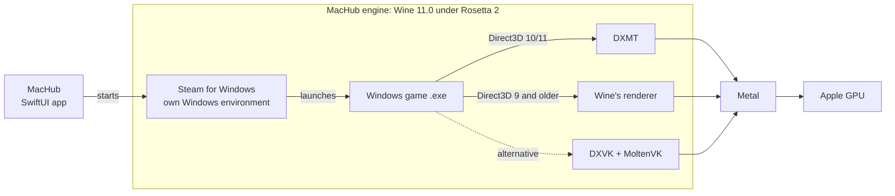

<p align="center">
  
</p>

<h1 align="center">MacHub</h1>

<p align="center">
  <b>Play your Windows games on a Mac with Apple silicon.</b><br>
  One library, one click to play, one click for mods. Free and open source.
</p>

<p align="center">
  <a href="https://github.com/machub-app/machub/releases/latest"></a>
  <a href="https://github.com/machub-app/machub/releases"></a>
  
  
  <a href="LICENSE"></a>
</p>

<p align="center">
  <a href="https://github.com/machub-app/machub/releases/latest"><b>Download MacHub</b></a> ·
  <a href="#installation">Installation</a> ·
  <a href="#how-it-works">How it works</a> ·
  <a href="#faq">FAQ</a> ·
  <a href="README.fr.md">Français</a>
</p>

<p align="center">
  
</p>

---

## What is MacHub?

Most games are made for Windows. MacHub lets you install and play them on your Mac without Windows, a virtual machine, or a paid tool.

MacHub is a native macOS app (SwiftUI). It brings everything together in one console-style library:

- your **Steam account** and store;
- a **Windows compatibility engine** built into the app (Wine, DXMT and DXVK), so you don't need Whisky, CrossOver or anything else;
- **Steam for Windows**, set up for you in its own isolated Windows environment;
- **mods**, installed safely and removed in one click.

You sign in to Steam, pick a game, click **Install**, then **Play**.

## Features

### 🎮 One library for all your games
- Your Steam games, what's installed on this Mac, and recently played titles in one place.
- **Discover:** search the Steam store from MacHub, with a page for each game.
- Native Mac games are recognised and opened through Steam for Mac, without Wine.

<p align="center"> </p>

### 🍷 A built-in Windows engine
- **Wine 11.0**, built by MacHub from the official WineHQ sources with our own macOS patches.
- **DXMT** turns Direct3D 10 and 11 into Metal: the fastest path for DirectX 11 games on Apple silicon.
- **DXVK** is available as an alternative for games that misbehave on DXMT.
- Engine versions install side by side and are checked by SHA-256. If a new one misbehaves, go back to the previous one in a click.
- Each Windows environment is isolated: settings, saves and programs never mix, and nothing is installed outside MacHub's folders.

### 🚂 Steam for Windows, handled for you
- MacHub downloads Valve's official installer and sets up Steam in its own environment.
- You sign in in Steam's own window. **MacHub never sees your password.**
- Download progress, updates and verification are shown in MacHub.

### ⚙️ Settings per game
- **Direct3D layer picked automatically** from the DirectX version each game uses, or chosen by hand.
- **Launch options**, like Steam's (for example `-gfx dx11`).
- **Performance summary** after each session (average FPS, lows, memory), read from macOS's Metal HUD. Nothing is injected into the game.
- From the game's **…** menu: Update, Verify Game Files, Show Game Folder, Steam Properties, Stop, Uninstall.

<p align="center"> </p>

### 🧩 Mods, safely
- **Nexus Mods catalog** for BeamNG.drive, Cyberpunk 2077 and Dead Island 2: search, sort, install in one click, turn mods on and off, remove them cleanly.
- **Modrinth** for Minecraft Java, with a separate Fabric profile so your worlds stay untouched.
- **Assetto Corsa:** safe import of cars and tracks from a `.zip`.
- Every file MacHub replaces is backed up first, and removing a mod puts it back.

### 🕹️ Controllers
- See every controller macOS detects (Xbox, DualSense, DualShock, Switch Pro, MFi), test each button and the vibration, and check what Windows games receive.

## Installation

1. **Download** `MacHub.dmg` from the [latest release](https://github.com/machub-app/machub/releases/latest).
2. Open it and **drag MacHub into Applications**.

   

3. Open MacHub. It is signed and notarized by Apple, so it opens like any other app.
4. If Rosetta 2 isn't installed yet, MacHub shows the one command to run (Wine runs through Apple's translator).
5. In **Settings › Windows Engine**, MacHub downloads its engine (about 240 MB, once).
6. In **Settings › Steam for Windows**, click **Install Steam for Windows**, then sign in in Steam's window.
7. Pick a game, click **Install**, then **Play**.

**Requirements:** a Mac with Apple silicon (M1 or later), macOS 15 or later, and space for your games.

## How it works



- **Wine** turns Windows calls into macOS calls. It is built for Intel and runs through Rosetta 2.
- **DXMT** and **DXVK** turn Direct3D into Metal, which the Apple GPU understands.
- MacHub reads each game's imports to pick the right layer. It puts the DLLs next to the game and never replaces DLLs the game ships itself.
- The engine is published as its own release, with its exact sources and patches ([docs/ENGINE.md](docs/ENGINE.md)).

## Tested games

| Game | Status | Notes |
|---|---|---|
| BeamNG.drive | ✅ Plays | Direct3D 11 through DXMT. `-gfx dx11` skips the game's launcher |
| Assetto Corsa | ⚠️ Launcher only | The launcher's menu stays black under Wine |

MacHub doesn't claim a game works until it has been tested. Tried a game? [Tell us how it went](https://github.com/machub-app/machub/issues/new/choose).

## Known limitations

- **DirectX 12** needs Apple's D3DMetal, which nobody may redistribute. MacHub guides you to download it from Apple. Sending DirectX 12 games to it stays off until it has been tested.
- Games with **kernel-level anti-cheat** don't run under Wine.
- Some intro videos may not play (no GStreamer in the engine yet).
- Steam's own window is rendered by the processor, which is a bit heavier than on Windows. Games themselves are unaffected.

## Privacy

- MacHub never sees or stores your Steam password. You sign in on Steam's site or in Steam's window.
- API keys (Steam Web API, Nexus Mods) stay in the macOS Keychain.
- Logs and settings stay on your Mac. MacHub sends nothing anywhere.

## FAQ

<details>
<summary><b>Is it free?</b></summary>
Yes, free and open source under GPLv3. You still need to own your games.
</details>

<details>
<summary><b>Do I need Whisky or CrossOver?</b></summary>
No. MacHub has its own engine. Whisky still works as a fallback for bottles you already have.
</details>

<details>
<summary><b>Does it work on Intel Macs?</b></summary>
No, MacHub needs Apple silicon.
</details>

<details>
<summary><b>Will my favourite game run?</b></summary>
Many DirectX 9, 10 and 11 games can, but every game is different. Check <a href="#tested-games">Tested games</a> and the issues, and share your results.
</details>

<details>
<summary><b>Where are my games and saves?</b></summary>
In <code>~/Library/Application Support/app.machub.MacHub/Prefixes/</code>, one folder per Windows environment. Steam Cloud keeps syncing your saves as usual.
</details>

## Building from source

```bash
git clone https://github.com/machub-app/machub.git
open machub/MacHub.xcodeproj   # then run the MacHub scheme
```

Xcode 26 or later is required. To build the Windows engine yourself, see [docs/ENGINE.md](docs/ENGINE.md).

## Roadmap

- [x] Built-in Windows engine, Steam for Windows, DXMT
- [x] Game management and performance summary
- [x] Nexus Mods catalog
- [ ] DirectX 12 through D3DMetal
- [ ] Automatic updates
- [ ] Epic Games and GOG
- [ ] Japanese and Chinese translations of the new screens

## Authors

MacHub is designed and developed by two brothers:

<table>
  <tr>
    <td align="center"><a href="https://github.com/mbielle"><br><b>Mathieu Bielle</b></a><br>Windows engine, Steam for Windows, mods</td>
    <td align="center"><a href="https://github.com/johan-bielle"><br><b>Johan Bielle</b></a><br>Interface, Steam, launches, controllers</td>
  </tr>
</table>

## Credits

MacHub stands on the work of these open-source projects:
[Wine](https://www.winehq.org) ·
[Gcenx's macOS Wine builds](https://github.com/Gcenx/macOS_Wine_builds) ·
[DXMT](https://github.com/3Shain/dxmt) ·
[DXVK-macOS](https://github.com/Gcenx/DXVK-macOS) ·
[MoltenVK](https://github.com/KhronosGroup/MoltenVK) ·
[llvm-mingw](https://github.com/mstorsjo/llvm-mingw) ·
[Whisky](https://github.com/Whisky-App/Whisky).
Full list and licenses: [docs/LICENSES.md](docs/LICENSES.md).

## License

MacHub is released under the [GNU GPL v3](LICENSE).

MacHub isn't affiliated with Valve, Apple, Nexus Mods or any game publisher. Steam, BeamNG.drive and the other names belong to their owners.
